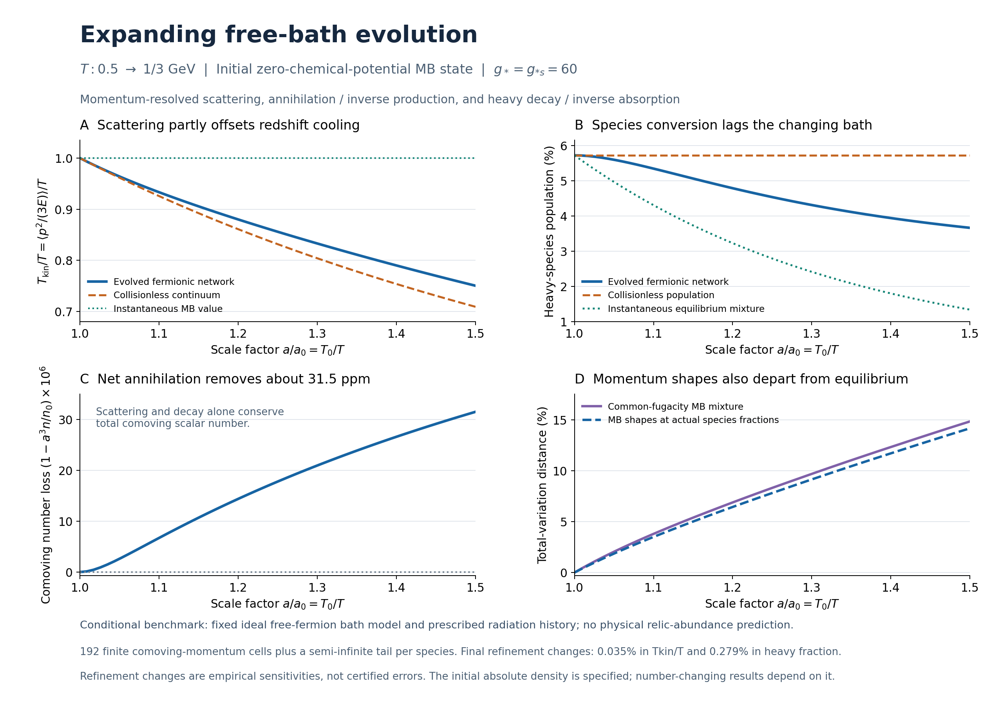

# Free-bath kinetic checkpoint — 21 October 2026

**Frozen computational checkpoint; public draft for review.** This snapshot preserves the three completed stages from the evening's free-bath investigation, including their code, numerical records, figures, proofs, controls, source provenance, and the earlier apparatus/EM dependency audit. The results are conditional on their stated models. Formal scientific release requirements remain those in [CLAIMS_AND_RELEASE_GATE.md](../../CLAIMS_AND_RELEASE_GATE.md).

## Start here

- [Scientific status and open work](SCIENTIFIC_STATUS.md): what each stage establishes and what remains open.
- [Discussion provenance](DISCUSSION_PROVENANCE.md): the Grok excerpts supplied by Christopher, their role, and external-link retrieval limits.
- [Checkpoint manifest](CHECKPOINT_MANIFEST.json): the three original ZIP hashes and all 114 preserved member hashes.
- [Artifact audit](ARTIFACT_AUDIT.txt) and [headline checks](HEADLINE_CHECKS.json): integrity and read-only cross-check records.

| Stage | Frozen package | Main result |
|---|---|---|
| Nested moments | [Research note](Free_Bath_Nested_Moments_2026-10-21/RESEARCH_NOTE.txt) | Enlarged scalar/drift trial spaces lower the slow rates by 5.1171% / 2.1130% at 0.4 GeV; finite-space variational interpretation retained. |
| Fixed-temperature momentum evolution | [Research note](Free_Bath_Momentum_Evolution_2026-10-21/RESEARCH_NOTE.txt) | The tested bulk-energy residual tracks enlarged scalar moments within the reported grid sensitivity; a separate conditional high-momentum argument gives zero uniform L2 gap. |
| Expanding fermionic network | [Research note](Expanding_Free_Bath_Fermionic_Network_2026-10-21/RESEARCH_NOTE.txt) | At 1/3 GeV: Tkin/T=0.750271, heavy fraction=0.0366322, comoving-number loss=31.5358 ppm, and within-species shape TV=0.141562. |



## Verify and reproduce

From this directory:

```bash
python restore_artifacts.py
python verify_checkpoint.py
python -m pip install -r Expanding_Free_Bath_Fermionic_Network_2026-10-21/requirements.txt
python Expanding_Free_Bath_Fermionic_Network_2026-10-21/reproduce_all.py
```

Four large collision banks are stored as ordered binary parts. `restore_artifacts.py` reconstructs their exact original bytes and checks both part and complete-file hashes. It preserves already matching files and refuses to overwrite a changed file. The following integrity check is read-only. Numerical reproduction writes the outputs described by each package; use a separate working copy to preserve this delivered snapshot. The expanding runner uses all six supplied raw banks by default; `--full` reconstructs those banks. The other two packages retain their own reproduction instructions and runners. No network is needed after dependencies are installed.

The publication check verified every archived member against its delivered SHA256, all three ZIP CRCs, and the newly assembled snapshot. Previously recorded numerical reproduction and refinement checks are retained; freezing does not replace them with a new simulation.

## Dated status and supersession

The first package's `NEXT_STEPS.txt` is preserved verbatim. Its proposed fixed-temperature momentum evolution and expanding fermionic evolution were subsequently carried out in the second and third packages, within their declared scopes. This dated checkpoint records that advancement without rewriting the earlier notes.

Thermal prehistory, initial-abundance derivation, interacting QCD and gluonic/hadronic matching, omitted physical reaction sectors, temperature-dependent thermodynamics, GATE-03 apparatus Objects 1–5, and the EM construction/normalization requirements remain open. The prior fixed-bath gap theorem is not automatically a theorem for the nonlinear expanding network. Numerical sensitivities are empirical refinements, not certified continuum errors.

## Attribution and citation

Christopher Michael Baird is the human project author. ChatGPT/Codex assisted with the numerical continuation, mathematical analysis, documentation, and internal computational review. Grok's user-supplied roadmap and interpretive comments informed the discussion; no independent Grok execution or external peer review is asserted. See [CITATION.cff](CITATION.cff). Existing repository licensing and all inherited source attributions are preserved.

The original three ZIP containers retain their separately delivered hashes. The repository preserves every member byte-for-byte, using ordered binary parts for four large collision banks; restore those files before running a package directly. This avoids duplicate ZIP containers while retaining all original data and hashes. Cite the immutable Git commit containing this checkpoint together with its manifest.
